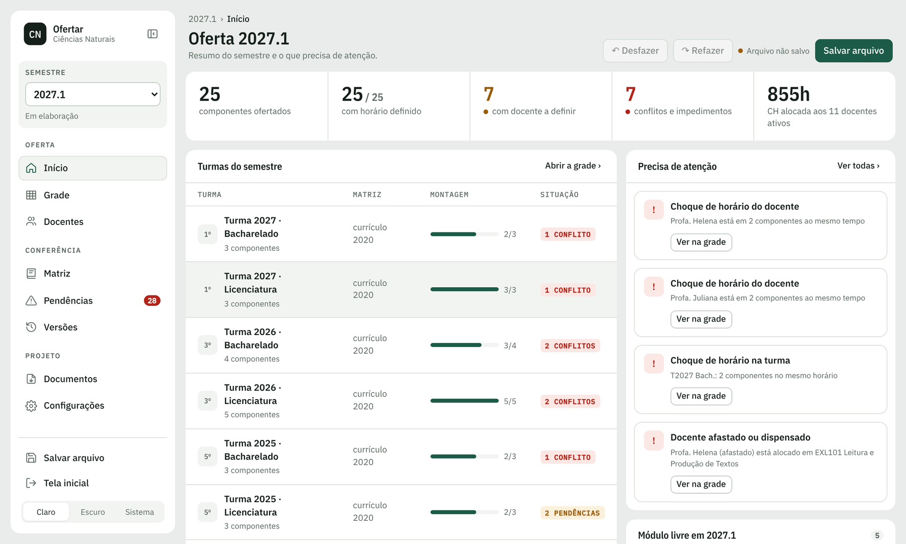

<p align="center"></p>

# Ofertar

**Organizador de ofertas de disciplinas para coordenações de curso.**

O Ofertar ajuda a coordenação a montar a oferta de disciplinas do semestre: a grade de cada turma, a distribuição da carga horária docente, a conferência com a matriz curricular e os documentos que precisam ser enviados (discentes, docentes, Departamento e outros colegiados).

Desenvolvido no **Laboratório Multidisciplinar de Ensino (LAMEN)** da **Universidade Federal do Amapá (UNIFAP)**.

- **Usar agora:** https://ofertar-cyan.vercel.app (instalável no computador e funciona offline)
- **Manual de uso (PDF, com telas):** [`docs/Manual-Ofertar.pdf`](docs/Manual-Ofertar.pdf)
- **Usar sem internet, num arquivo só:** [`app/index.html`](app/index.html) (baixe e abra no Chrome ou no Edge)



## Por que existe

A oferta costuma ser montada num documento de texto com uma tabela por turma. Essa mesma informação é depois redigitada na tabela de carga horária docente, no quadro de componentes "a definir", no memorando aos outros colegiados, no quadro enviado ao Departamento e em cada versão (prévia, discentes, docentes, final). Com isso, é fácil um docente aparecer em duas turmas no mesmo horário, a carga horária não bater com a grade ou uma obrigatória ficar de fora.

No Ofertar existe **uma base só**: você monta a grade e o resto é calculado a partir dela.

## O que faz

| Área | Recursos |
|---|---|
| **Grade** | Quadro semanal por turma (manhã, tarde e noite), marcação de horários por clique, turmas conjuntas (ex.: Lic. + Bach.), vários docentes por componente com divisão de CH, módulo livre, optativas, cores por ano de ingresso, painéis recolhíveis |
| **Conferência automática** | Choque de horário de docente e de turma; docente afastado alocado; CH do docente maior que a do componente; aulas por semana × CH; componente sem docente; CH alocada × prevista (PAID) e mínimo de ensino; obrigatórias do período fora da oferta; códigos fora da matriz da turma |
| **Docentes** | Carga horária somada da grade, CH na pós-graduação, função, redução PAID, horário semanal de cada docente |
| **Matriz** | Várias matrizes por habilitação, escolhidas pelo ano de ingresso da turma; importação por CSV com modelo |
| **Versões** | Guarda a versão enviada e mostra exatamente o que mudou (horários, docentes, CH, turmas) |
| **Documentos** | Word para discentes; Word para docentes (com distribuição da CH, docentes a definir e externos); **quadro de ofertas para o Departamento** com horário no padrão Sigaa (ex.: `T1234`); planilha de CH (CSV); rascunho de memorando por colegiado |
| **Semestres** | Novo semestre reaproveitando o mesmo período do ano anterior, com as turmas avançadas automaticamente |

Os dados ficam **no navegador e no arquivo `.json`** que você salvar. Nada da oferta é enviado para servidores.

## Como usar

1. Abra https://ofertar-cyan.vercel.app no Chrome ou no Edge (ou o arquivo `app/index.html`).
2. Escolha **Explorar um curso de exemplo** para conhecer, ou **Começar um curso novo**.
3. Em **Configurações**, cadastre habilitações, horários, matrizes (CSV) e turmas do semestre. Na aba **Docentes**, cadastre os docentes.
4. Monte a **Grade** de cada turma e acompanhe **Pendências**.
5. Use **Salvar arquivo** para gravar o `.json` na pasta da coordenação (OneDrive, Google Drive). Esse arquivo é a cópia de segurança e o que outra pessoa abre para continuar o trabalho.
6. Em **Documentos**, baixe os arquivos para discentes, docentes e Departamento.

O passo a passo completo, com telas, está no [manual](docs/Manual-Ofertar.pdf).

## Adaptar para outro curso

Tudo o que é específico de um curso fica em **Configurações** e nos dados do projeto: habilitações e coordenadores, número de períodos, horários das aulas, horas por aula semanal, CH mínima de ensino, matrizes, cabeçalho e orientações do quadro do Departamento e cores das turmas. Nenhuma alteração no código é necessária.

- Modelo de matriz: [`exemplos/modelo-matriz.csv`](exemplos/modelo-matriz.csv)
- Projeto de exemplo (curso fictício): [`exemplos/curso-exemplo.json`](exemplos/curso-exemplo.json)
- Formato do arquivo de projeto: [`docs/formato-do-projeto.md`](docs/formato-do-projeto.md)

### Importar ofertas antigas feitas no Word

Se as ofertas anteriores estão em `.docx`, no formato "uma tabela por turma", o script `scripts/importar_docx.py` cria o semestre no projeto:

```bash
pip install python-docx
python scripts/importar_docx.py Ofertas_2027_1.docx meu-projeto.json 2027.1 \
  --turmas 2027-BACH,2027-LIC,2026-BACH,2026-LIC,2025-LIC,2025-BACH,2024-LIC,2024-LIC,2024-BACH,2024-BACH
```

`--turmas` lista, na ordem das tabelas do documento, o identificador de cada turma (`ANO-HABILITAÇÃO`). Depois abra o projeto no app e confira a aba Pendências.

## Desenvolvimento

```bash
pnpm install
pnpm dev      # servidor local de desenvolvimento
pnpm build    # gera dist/ (index.html autocontido + manifesto, ícones e service worker)
```

React + TypeScript + Vite. Os documentos Word são gerados no navegador com [`docx`](https://github.com/dolanmiu/docx). O build é um único HTML (`vite-plugin-singlefile`), por isso o app funciona publicado num endereço e também aberto direto do computador.

```
src/lib/types.ts      modelo de dados (projeto, semestre, turma, componente, docente, matriz)
src/lib/model.ts      regras: período da turma, matriz, conferências, diferenças entre versões, novo semestre
src/lib/exportar.ts   documentos Word, quadro do Departamento, CSV e memorando
src/lib/storage.ts    navegador (localStorage) e arquivo .json
src/components/       telas
public/               manifesto, ícones e service worker (app instalável e offline)
scripts/              importador de ofertas em .docx
docs/                 manual (PDF e fonte HTML), telas e marca (docs/marca: logo em SVG)
```

Publicação: veja [`docs/publicar.md`](docs/publicar.md).

## Autor

**Francisco Diego Barros Barata** — Laboratório Multidisciplinar de Ensino (LAMEN), Universidade Federal do Amapá (UNIFAP)
ORCID: [0000-0002-1640-5630](https://orcid.org/0000-0002-1640-5630) · Lattes: [1702223554115381](http://lattes.cnpq.br/1702223554115381)

## Como citar

BARATA, Francisco Diego Barros. **Ofertar: organizador de ofertas de disciplinas para coordenações de curso**. Versão 1.0.0. Macapá: Laboratório Multidisciplinar de Ensino (LAMEN), Universidade Federal do Amapá, 2026. Software. Disponível em: https://github.com/baratadiego/ofertar.

Os metadados de citação estão em [`CITATION.cff`](CITATION.cff); o GitHub mostra o botão "Cite this repository". Após o arquivamento no Zenodo, use o DOI da versão.

## Segurança e privacidade

O app não tem servidor: os dados ficam no navegador e no arquivo `.json` de quem usa. Detalhes e como relatar problemas: [`SECURITY.md`](SECURITY.md).

## Licença

[MIT](LICENSE). É permitido usar, copiar, modificar e redistribuir, mantendo o aviso de direitos autorais.
