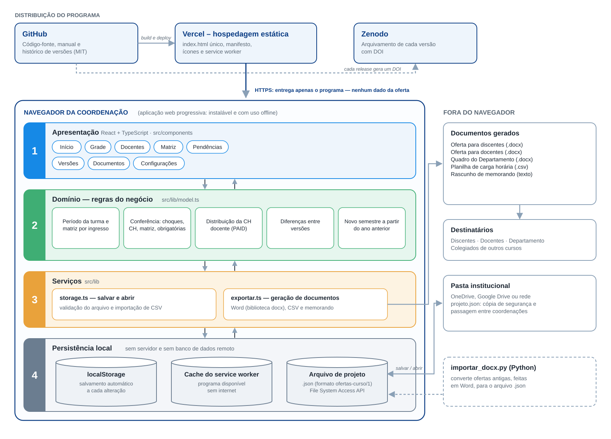
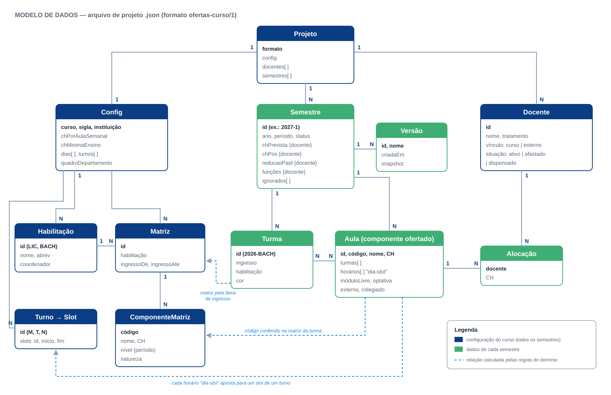
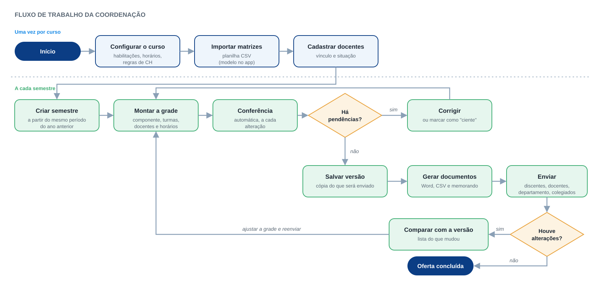

# Arquitetura do Ofertar

O Ofertar é uma aplicação web progressiva (PWA) que roda inteiramente no navegador. **Não há servidor de aplicação nem banco de dados remoto**: a hospedagem pública entrega só o programa, e os dados da oferta ficam no computador da coordenação.

## Camadas



| Camada | Onde está | Responsabilidade |
|---|---|---|
| 1. Apresentação | `src/components/` | Telas: Início, Grade, Docentes, Matriz, Pendências, Versões, Documentos e Configurações (React + TypeScript) |
| 2. Domínio | `src/lib/model.ts` | Regras do negócio: período da turma e matriz por ano de ingresso; conferência (choques, carga horária, matriz, obrigatórias); distribuição da carga horária docente (PAID); diferenças entre versões; novo semestre |
| 3. Serviços | `src/lib/exportar.ts`, `src/lib/storage.ts` | Geração dos documentos (Word com a biblioteca `docx`, CSV e memorando); salvar, abrir e validar o arquivo de projeto; importar matriz em CSV |
| 4. Persistência | navegador + arquivo | `localStorage` (salvamento automático), arquivo `.json` do projeto (File System Access API, com alternativa de download) e cache do service worker (uso offline) |

As telas nunca gravam dados diretamente: elas chamam as regras do domínio, e o resultado é salvo pela camada de persistência a cada alteração.

**Distribuição:**
- **GitHub** guarda o código.
- **Vercel** publica o build estático a cada envio para `main`: um `index.html` autocontido, mais manifesto, ícones e service worker.
- **Zenodo** arquiva cada *release* com DOI.

## Modelo de dados



- **Azul — configuração do curso:** vale para todos os semestres (habilitações, matrizes, turnos).
- **Verde — dados de cada semestre:** turmas, componentes ofertados, alocações e versões.
- **Linhas tracejadas — relações calculadas pelas regras do domínio**, não gravadas no arquivo:
  - a matriz de cada turma vem da faixa de ingresso;
  - o código de cada componente é conferido na matriz da turma;
  - cada horário `dia-slot` aponta para um slot de um turno.

Detalhes de cada campo: [`formato-do-projeto.md`](formato-do-projeto.md) e [`src/lib/types.ts`](../src/lib/types.ts).

## Fluxo de trabalho da coordenação



## Atualizar os diagramas

Os diagramas são gerados por código, para ficarem coerentes com o projeto:

```bash
cd docs/diagramas && python3 ../../scripts/gerar_diagramas.py
```
